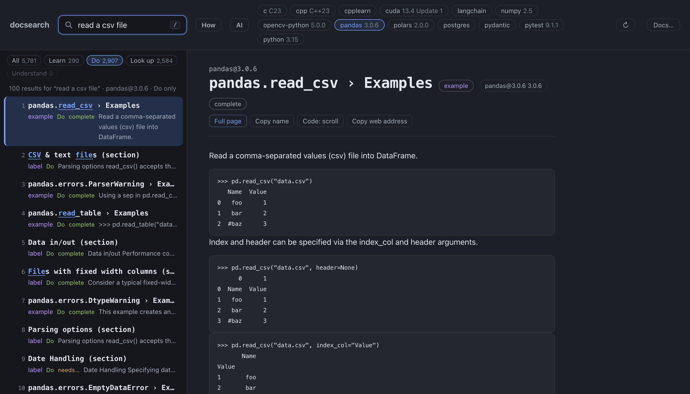

[This project isHard Vibe coding]

# docsearch

search docs from your terminal. read them in your browser. offline.

reading documentation is hard. it's spread over a dozen sites, each with its own layout,
its own search box, its own idea of where things go. you know the function exists, you
just can't remember what it's called or which page it's on.

sure, an llm can write the code for you. but sometimes you want to write it yourself and
just need to look things up fast. for a forgetful brain like mine. without leaving the
terminal.

so: type what you remember, get the official docs.

```bash
search np.sum                             # by name
search lnsvd                              # by a few letters
search dataframe.mrege                    # typos are fine
search sum of elements along an axis      # by meaning
search how join two tables                # how to do it: guides, how-tos, examples first
search ai how do i drop duplicate rows    # a question, ranked by a small local model
```

your browser opens with results on the left and the docs on the right (safari on a mac).
that's it.



## what's in it

nothing until you add it. you pick the docs: any python package on pypi (numpy, pandas,
torch...), languages and toolkits by name (python, rust, c, c++, go, javascript, ocaml,
cuda, mojo, max, git: see `search known`), any docs site by its address, a docs folder or
zip you downloaded, and articles you like.

everything runs on your computer. once the docs are downloaded, nothing goes online.

## install

paste one block in a terminal. it works out what your computer has: on a mac with apple
silicon the models run on the gpu, everywhere else on the processor. needs
[git](https://git-scm.com) and [uv](https://docs.astral.sh/uv/) (no uv yet? windows:
`winget install astral-sh.uv`, mac and linux: `curl -LsSf https://astral.sh/uv/install.sh | sh`,
then open a new terminal). uv also gets python 3.11+ if you don't have it.

### mac, linux and wsl

```bash
git clone https://github.com/ahmad-sardar/docsearch ~/docsearch && cd ~/docsearch
uv sync
.venv/bin/search setup        # downloads the models, once
sh=$(basename "$SHELL"); rc=~/.${sh}rc     # ~/.zshrc or ~/.bashrc
[ "$sh" = zsh ] && ng="noglob " || ng=""   # zsh: [ ] * ? in a search stay as typed
echo "alias search='$ng$HOME/docsearch/.venv/bin/search'" >> $rc && source $rc
```

on wsl (linux inside windows) the results open in your windows browser. wsl and windows
are separate copies with their own docs and models, so install in the one you'll use.

### windows

in powershell:

```powershell
git clone https://github.com/ahmad-sardar/docsearch $HOME\docsearch
cd $HOME\docsearch
uv sync
.venv\Scripts\search setup       # puts search on your PATH, downloads the models, once
$env:Path = "$HOME\docsearch\bin;$env:Path"      # search in this window too (new ones have it)
```

then add the docs you want (see [adding docs](#adding-docs)):

```bash
search add numpy pandas rust
```

setup stopped halfway? run it again: what's already downloaded is checked and kept.

no gpu needed. on a mac with apple silicon the models run on the gpu, everywhere else on
the processor: same results (measured, see `eval/results-backends.md`), just slower.
`search ai` takes ~6.5 s instead of ~3 s on a fast processor, more on a slow one, and
computing the vectors in `search add` takes longer. plain search is
still instant. needs ~3 GB of memory with ai. no man pages on windows.

hugging face blocked on your network? `search setup` notices and gets the same model files
from this repo's [release](https://github.com/ahmad-sardar/docsearch/releases/tag/models-v1)
instead, checked against the same hashes. or copy `data/models` over from a computer that
has it.

everything you add is listed in `packages.toml` (yours, not in git). edit it and run
`search sync`, or copy it to another computer and run `search setup` there to get the same
docs.

## use

```bash
search numpy svd              # just numpy
search how pandas pivot       # how to do it, in pandas' guides (plain search: the reference)
search                        # open the page
search list                   # what you have, and which version
search stop                   # stop the background server
search --help                 # every command (search add --help: its options)
```

in the page:

| key | does |
|---|---|
| type | search |
| ↑ ↓ | pick a result |
| enter | open the full page |
| esc | back |
| / | jump to the search box |
| w | wrap long code lines |
| c | copy the name |
| s | the source code it documents (when its docs link to it) |
| ⌘↩ / ctrl+enter | rank this search with ai, once |

before you type anything, the page shows each package's docs organized by what you read
them for (next section), and the list goes through them in reading order.

searching every package from a project: what is named as you typed comes first, then your
project's own packages, then the other docs of its languages, then the rest (a python project
asking "sort a list" gets python's `list.sort`, not c++'s `std::list::sort`). two results of
one name say where each is (its page, its folder, or its parameters).

### organized by what you read them for

official docs mix everything together. docsearch sorts every entry into one of four, using
only the docs' own words (a page's title, or the part of their table of contents it's in):

- **learn**: tutorials, getting started, quickstarts (the python tutorial, numpy quickstart)
- **do**: how-tos, user guides, faqs, installing (python howtos, pandas user guide)
- **look up**: the reference, every function and class (numpy reference, the standard library)
- **understand**: fundamentals, concepts, internals (numpy fundamentals)

the page's home shows each package that way: each part (as its docs name it) with the pages
under it. results say what they're for. `search list numpy` counts them.

two searches, for two questions:

- **plain `search`: what** something is. the reference and the explanations (look up,
  understand): `search np.sum`, `search broadcasting`. names come first, as always.
- **`search how`: how** to do something. the tutorials, guides, how-tos and examples (learn,
  do) and the functions that do it come first, then the rest: `search how read a json file`. in the page, the **How** button switches, or start what you
  type with "how". with ai: `search ai how pandas pivot a table`.

examples are units of their own in `search how`: a function's "examples" part, with the text
around it, stays linked to the function (enter opens its page), and cppreference's example
programs too. each says whether its code is complete, read from the code itself: "complete",
or what it needs first ("needs df (from earlier)", "needs import polars as pl"). numpy's and
pandas' examples assume `np` and `pd`, as their docs say.

measured on the stack overflow questions (`eval/results-organized.md`, test split, 348
questions, once): plain search 0.246 against 0.255 for every entry (p=0.45), names 0.958
against 0.964; `search how` 0.267, names too (0.957). on the 27 questions whose answer is a
tutorial or how-to, `search how` scores 0.28 against 0.18: better, but too few questions to be
sure.

pages about the project, not about using it, are left out: release notes, what's new,
contributing and development, building from source, the license (pandas: 2,495 release-note
entries). sphinx docs skip them before downloading. and parts listed apart from the entry
that already holds them are folded into it: cppreference's "parameters", "return value",
"see also" sections (in the c++ docs, 6 of every 10 entries were these), a section that
repeats its page's title, numpy.sum's page next to numpy.sum, one section reached by two
names. changelogs and blog pages are left out too.

a page's purpose comes from the docs' own structure: its title, their table of contents, the
site's own sections (its sidebar, llms.txt), not from the page above it by its address
(litellm's first page, "getting started", is not what its gateway docs are). the parts in the
page's home are the site's own sections (langchain: build, monitor, deploy, test). an api
reference written as markdown pages (reference.langchain.com) gives api entries named from
their address (`langchain.agents.factory.create_agent`), so names find them. docs you added
before are organized once, the next time you run `search`, with nothing downloaded.

### official guides, with their docs

some packages keep their guide apart from their reference: polars' api reference links its
user guide on docs.pola.rs, numpy's docs link their tutorials ("learn") on numpy.org. when a
package's docs link such a guide in their own header, docsearch reads it with them, as part of
the same copy, organized the same way (polars' "getting started" is learn, its "concepts"
understand). only official ones: on the docs' own site, or a site that links to the package's
repository; only a link named as a guide ("user guide", "tutorials", "learn"; not "learn more");
only a docs site (one that lists its pages, or says what built it; not a site with only a
sitemap); never the same docs at another version. a guide has no versions, so it says the day
it was read ("user guide, as of 2026-10-12"), and it comes only with the docs of the newest
release.

```bash
search add polars                                  # its user guide comes with it
search add mylib --guide https://mylib.dev/guide/  # one its docs don't link (kept in packages.toml)
```

docs you added before guides: `search add polars` (or `search sync`) adds their guides,
without downloading the docs again.

### search tricks

- `"drop_duplicates"` in quotes: exact match only
- `/^numpy\.linalg\./` between slashes: regex on names
- `search -e drop_duplicates`: exact match from the terminal (the shell eats quotes)
- symbols in a query, `( ) < > [ ] { } # $ ! * ? & | ; ~`: put it in single quotes,
  `search python 'Path()'`, `search rust 'Vec<T>'`. without them the shell reads those
  characters itself: it refuses the command (`Path()`), or changes the query before docsearch
  sees it (`#define` disappears, `$PATH` becomes your path). or type it in the page:
  `search python`, then type.
- `search ai ...`: for questions and ideas. a small model on your computer reorders the
  top results. slower (~3 s on a mac), better for "how do i...". plain search is better
  for names.

## adding docs

```bash
search add polars                        # a pypi package
search add rust go                       # languages, see: search known
search add mydocs=https://docs.example.com/
search add mydocs=~/Downloads/docs.zip   # docs you downloaded yourself (or C:\path on windows)
search remove polars
```

a package's docs are found through its source code. pypi names its repository (github,
gitlab, codeberg), and docs count as the package's when they and the repository point at each
other: the docs link to it, or it names their site as its website. that finds the right docs
when pypi's own link is old or points elsewhere, and docs that point neither way are shown to
you before anything is downloaded (`--yes` takes them). the project's own home page (as pypi or
its repository names it) vouches for the docs it links to, by their address or a link named
"docs" or "documentation", never a "contribute" or "blog" page; so does pypi's description of
the package. a package that names no docs site at all gets the readme of its release, which is
its documentation, and so does one whose docs site only lets people in, not programs (a bot
check, which docsearch never gets around). in packages.toml, `name = { url = "..." }` is where
`search add name` and `search sync` read it.

the code an entry documents comes along, where the docs link to it (numpy, pandas, torch,
scipy, polars, matplotlib, go...): press `s` on the entry to read it, at the version the docs
were built from, offline like everything else.

a docs site gives you every page under the address you add. big sites (azure, aws, google
cloud, oracle) have tens of thousands, so add the part you want, one product or book:

```bash
search add aks=https://learn.microsoft.com/en-us/azure/aks/
```

- before it starts, it says how many pages there are, when the site's sitemap tells; then
  the bar shows how many are read, of how many, and the time left. without a sitemap it
  shows how many are found so far, a number that grows as pages turn up.
- ctrl+c stops it and keeps what's read: searchable now, marked partial in `search list`.
  `search add aks` continues where it stopped.
- docsearch reads what the site lists for programs (a sphinx inventory, an mkdocs search
  index, llms.txt, its sitemaps), as markdown where the site offers it and its html is drawn by
  javascript (docs.langchain.com), and says how many of the listed pages it read.
- a site with pages for other languages than the package's (langchain's typescript next to its
  python), or with many sections (tensorflow.org), asks which sections to read when you add it
  in a terminal; the answer is kept in packages.toml, for that site, and sync asks no more.
  without a terminal it reads all but the other languages' pages and says so.
- some sites ask programs to wait between pages, and docsearch waits. aws asks for 5
  seconds, so 700 pages take about an hour. a site that says how many requests it allows
  (huggingface.co: 100 pages in 5 minutes) is asked no faster than that; one that asks for a
  longer pause (come back in an hour) stops the download, kept, and the same command goes on
  after that time. a big site can take a few sittings; so can updating it.
- a site whose robots.txt can't be read (it answers with a server error) is not read at all
  that time, as the robots.txt standard (rfc 9309) says.
- hugging face's libraries (transformers, datasets, diffusers...) come from hugging face's own
  copy of their docs: one download, no page of its site asked for.
- some sites ask programs not to read some pages at all (oracle: its old releases, 10g
  and 11g), and docsearch doesn't. download those docs yourself and add the folder or zip:
  `search add oracle11=~/Downloads/oracle11g.zip`

## versions

every version you pull is kept as a copy of its own, until you remove it.

```bash
search upgrade                 # the newest docs of every package, next to the ones you have
search upgrade numpy           # one package
search upgrade numpy==1.26     # an older version
search list                    # every copy, and the one search uses
search list numpy              # numpy's copies: choose the one search uses
search remove numpy@1.26       # remove one copy
```

a version you have is not downloaded again. docs without a version number (MDN) and docs you
added by address or from a folder are one copy, downloaded again in place.

which copy a search uses:

- in a project folder: the version the project uses, when you have it (from its `.venv`,
  `uv.lock`, `poetry.lock`, `requirements.txt`, `.python-version` or `requires-python`,
  `go.mod`, `rust-toolchain.toml` or `rust-version`)
- else the one you chose with `search list numpy`
- else the only one; with several and none chosen, search asks once

for one search: `search numpy@1.26 svd`, or the version menu in the page. `packages.toml`
lists the versions you pulled and the one you chose, so `search sync` on another computer
gets the same.

releases that are not out yet are versions too, where the docs site publishes them: nightly
(also called dev or main), beta (rc) and alpha. the stable docs stay the default, and search
never chooses a nightly or beta for you.

```bash
search add max==nightly             # next to the stable max docs
search add rust==beta python==nightly numpy==nightly pandas==beta
search upgrade max==nightly         # a new nightly copy (each one is named by its day)
```

`search known` shows which ones each built-in site has.

### what docs correspond to

each copy says which version of the software it describes, never when it was downloaded:

- a release: numpy 2.5, python 3.14. docs that don't print their number are known by the
  release their source links name (polars: 2.0.0)
- development docs, of the release to come: `in development, after 3.8.0` (triton and jax
  build theirs from main)
- one standard of a language: C and C++ come one copy per standard (below)
- the language as it is now: MDN has no versions
- docs that say nothing show no version

c and c++ (cppreference) are one site for every standard, each page marking what came with
which one. it is downloaded once and kept aside, and each standard you ask for becomes a copy of
its own, made from it in seconds: what that standard has, nothing added later, nothing removed
before, the pages showing only its rows.

```bash
search add cpp                 # C++23: the current standard, as cppreference says
search add cpp==17 c==11       # C++17 and C11, made from the same download
search add cpp==26             # a draft standard (cpp@26-draft), when you ask for it
```

entries carry their own marks too: cppreference's standards, and the `added in 3.13` of
python's docs and most python libraries. in a project folder, search compares them with the
project: results newer than its version or standard are marked (`std::format` in a C++17
project; `itertools.batched` in a project on python 3.11), and so are ones removed in it.
the standard comes from its `CMakeLists.txt`, `meson.build`, `Makefile` or
`compile_commands.json`.

## saving tutorials

found a good article? keep it.

```bash
search save https://realpython.com/python-f-strings/
search save https://docs.python.org/3/tutorial/classes.html --series   # and the next parts
search save URL --to rust-stuff                                        # your own folder
```

it keeps the article, drops the ads and menus, and makes it searchable with everything else.

## when downloads fail

it tells you why (site down, blocked, moved, needs javascript...) and what to try. your
existing docs are never touched until a new download fully works: it replaces them when it
read nine in ten of the pages the site lists, with few failed (where nothing says how many
there are, when it has most of the entries yours has). if a site won't let programs in,
download the docs yourself and `search add name=/path/to/folder`.

## safe

- offline after setup. the search can't reach the internet even by accident.
- downloaded pages are stripped of scripts before you see them. source code is kept as text and
  shown highlighted; nothing in it runs.
- models come from fixed versions and are checked by hash. no pickle files.

## how good is the search

measured, not guessed. see `eval/` if you care.

## license

MIT. use it however you like. (`eval/so_questions.json` has stack overflow titles, which
stay cc by-sa 4.0.)

## contributors

- [@ahmad-sardar](https://github.com/ahmad-sardar)
- claude (anthropic), co-author
